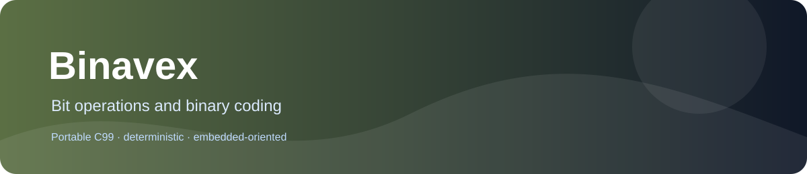

# Binavex
  



Bit masks, permutations, Gray coding, parity, bitset operations and xorshift support.

## Why it exists

Firmware protocols and packed data paths require small, deterministic bit-level operations.

## What is included

- Portable C99 implementation.
- Deterministic integer behavior documented in the public headers.
- No mandatory heap, threads or operating-system services.
- Separate translation units for selective linking.

## Quick start

```sh
cmake -S . -B build -DBINAVEX_BUILD_TESTS=ON -DBINAVEX_STRICT_WARNINGS=ON
cmake --build build --parallel
ctest --test-dir build --output-on-failure
```

For a minimal integration, include the required public header and compile its matching source unit, or link the static CMake target. Binavex does not require the rest of PrimitiveCore.

## Documentation

| Need | Read |
|---|---|
| Choose a primitive | [Family guide](docs/FAMILY_GUIDE.md) |
| Check every function and contract | [API reference](docs/API_REFERENCE.md) |
| Reproduce tests and see validation limits | [Testing report](docs/TESTING.md) |
| Review design and dependencies | [Architecture](docs/ARCHITECTURE.md) |
| See measured embedded performance | [Performance](docs/PERFORMANCE.md) |

## Public API and validation

The public surface contains 37 headers and 37 callable API entries under `include/`. All 37 APIs have direct enabled checks in the deterministic audit test, in addition to 26 original unit test programs. The host matrix, sanitizer evidence and hardware limits are recorded in `docs/TESTING.md`.

The current COM37 ESP32-S3 validation passed all 37 APIs. Cycle measurements, link-map library footprint and stack watermark observations are recorded in `docs/PERFORMANCE.md`. Xorshift is not cryptographically secure.

## License

Apache License 2.0, copyright Vanderhell. See [LICENSE](LICENSE) and [NOTICE](NOTICE).

## Origin

A standalone embedded-C library extracted from the PrimitiveCore product catalog. It is independently buildable and linkable.
