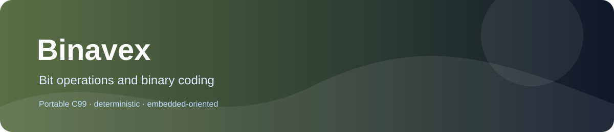

# Binavex
  



Bit masks, permutations, Gray coding, parity, bitset operations and xorshift support.

## Why it exists

Firmware protocols and packed data paths require small, deterministic bit-level operations.

## What is included

- Portable C99 implementation.
- Deterministic integer behavior documented in the public headers.
- No mandatory heap, threads or operating-system services.
- Separate translation units for selective linking.

## Quick start

```sh
cmake -S . -B build -DBINAVEX_BUILD_TESTS=ON -DBINAVEX_STRICT_WARNINGS=ON
cmake --build build --config Release --parallel
ctest --test-dir build -C Release --output-on-failure
```

For a minimal integration, include the required public header and compile its matching source unit, or link the static CMake target.

## Documentation

| Need | Read |
|---|---|
| Choose a primitive | [Family guide](docs/FAMILY_GUIDE.md) |
| Check every function and contract | [API reference](docs/API_REFERENCE.md) |
| Review audit findings and validation state | [Audit register](docs/AUDIT.md) |
| Reproduce tests and see validation limits | [Testing report](docs/TESTING.md) |
| Review design and dependencies | [Architecture](docs/ARCHITECTURE.md) |
| See measured embedded performance | [Performance](docs/PERFORMANCE.md) |

## Public API and validation

The public surface contains 37 headers and 37 callable API entries under `include/`. All 37 APIs have direct enabled checks in the deterministic audit test, in addition to 26 focused C unit programs and a C++ public-header smoke test. The host matrix, sanitizer evidence and hardware limits are recorded in `docs/TESTING.md`.

The pre-migration source revision passed all 37 APIs on ESP32-S3. That hardware run and its cycle/footprint data are historical; the namespace-migrated revision is `HW NOT VERIFIED`. See `docs/PERFORMANCE.md`. Xorshift is not cryptographically secure.

## License

Apache License 2.0, copyright Vanderhell. See [LICENSE](LICENSE) and [NOTICE](NOTICE).
