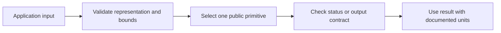

# Binavex family guide

## What this family solves

**Bit operations and binary coding.** Bit masks, permutations, Gray coding, parity, bitset operations and xorshift support.

This guide describes the complete public family as an independent embedded-C product. Each primitive remains separately linkable; select only the headers and source units required by the application.

## When to use this family

Use Binavex when the application needs the operations listed below and requires deterministic behavior, explicit caller-owned memory, and no mandatory operating-system services.

## Family at a glance

## Primitive map

| Public header | Symbol | Purpose and contract | Validation source |
|---|---|---|---|
| `include/binavex/bit/bit_byte_reverse_u32.h` | `binavex_bit_byte_reverse_u32` | Reverse bit order inside each byte; byte positions stay in place. | tests/test_bit_byte_reverse_u32.c; tests/test_audit_differential.c |
| `include/binavex/bit/bit_deinterleave4_u32.h` | `binavex_bit_deinterleave4_u32` | Reverse binavex_bit_interleave4_u32: packed bit 4*i+k becomes byte-lane k bit i. | tests/test_bit_deinterleave4_u32.c; tests/test_audit_differential.c |
| `include/binavex/bit/bit_error_syndrome_u32.h` | `binavex_bit_error_syndrome_u32` | Compute extended Hamming(39,32) syndrome: bits 0..5 encode the one-based error position (zero means none); bit 6 is overall parity mismatch. Check byte bit 7 is reserved. Failure leaves syndrome unchanged. | tests/test_bit_error_syndrome_u32.c; tests/test_audit_differential.c |
| `include/binavex/bit/bit_extract_u64.h` | `binavex_bit_extract_u64` | Extract inclusive bit range [first_bit,last_bit], right-aligned in *field. Reject invalid bounds or null output; failure leaves *field unchanged. | tests/test_audit_differential.c (direct tests; 100,000 deterministic cases where applicable) |
| `include/binavex/bit/bit_gather_u32.h` | `binavex_bit_gather_u32` | Pack value bits selected by mask, from lowest selected input bit to bit zero. | tests/test_bit_gather_u32.c; tests/test_audit_differential.c |
| `include/binavex/bit/bit_interleave4_u32.h` | `binavex_bit_interleave4_u32` | Interleave four byte lanes: input byte k bit i becomes output bit 4*i+k. | tests/test_bit_deinterleave4_u32.c; tests/test_audit_differential.c |
| `include/binavex/bit/bit_nibble_reverse_u32.h` | `binavex_bit_nibble_reverse_u32` | Reverse bit order independently inside each 4-bit nibble. | tests/test_bit_nibble_reverse_u32.c; tests/test_audit_differential.c |
| `include/binavex/bit/bit_pair_reverse_u32.h` | `binavex_bit_pair_reverse_u32` | Exchange adjacent bits (0 with 1, 2 with 3, through 30 with 31). | tests/test_bit_pair_reverse_u32.c; tests/test_audit_differential.c |
| `include/binavex/bit/bit_reverse_u64.h` | `binavex_bit_reverse_u64` | Reverse the order of all 64 bits; bit 0 becomes bit 63. | tests/test_audit_differential.c (direct tests; 100,000 deterministic cases where applicable) |
| `include/binavex/bit/bit_scatter_u32.h` | `binavex_bit_scatter_u32` | Deposit low value bits into mask positions in ascending bit order. | tests/test_bit_scatter_u32.c; tests/test_audit_differential.c |
| `include/binavex/bit/bit_shuffle_even_odd_u32.h` | `binavex_bit_shuffle_even_odd_u32` | Gather even source bits to output low half and odd source bits to high half. | tests/test_bit_shuffle_even_odd_u32.c; tests/test_audit_differential.c |
| `include/binavex/bit/bit_swap_u32.h` | `binavex_bit_swap_u32` | Exchange two bit positions, numbered from the least significant bit. | tests/test_bit_swap_u32.c; tests/test_audit_differential.c |
| `include/binavex/bit/bit_unshuffle_even_odd_u32.h` | `binavex_bit_unshuffle_even_odd_u32` | Interleave low-half bits into even positions and high-half bits into odd. | tests/test_bit_unshuffle_even_odd_u32.c; tests/test_audit_differential.c |
| `include/binavex/bit/bitset_count_ones_u32.h` | `binavex_bitset_count_ones_u32` | Return the population count of all 32 bits in word, in the range [0, 32]. | tests/test_bitset_count_ones_u32.c; tests/test_audit_differential.c |
| `include/binavex/bit/bitset_rotate_left_u32.h` | `binavex_bitset_rotate_left_u32` | Rotate all 32 bits left; any uint32 count is reduced modulo 32. | tests/test_bitset_rotate_left_u32.c; tests/test_audit_differential.c |
| `include/binavex/bit/clz_u64.h` | `binavex_clz_u64` | The public header contains the authoritative signature and input/output contract. | tests/test_audit_differential.c (direct tests; 100,000 deterministic cases where applicable) |
| `include/binavex/bit/ctz_u64.h` | `binavex_ctz_u64` | The public header contains the authoritative signature and input/output contract. | tests/test_audit_differential.c (direct tests; 100,000 deterministic cases where applicable) |
| `include/binavex/bit/deinterleave_nibbles_u32.h` | `binavex_deinterleave_nibbles_u32` | Recover the high/low halfword nibble streams from alternating nibble lanes. | tests/test_deinterleave_nibbles_u32.c; tests/test_audit_differential.c |
| `include/binavex/bit/even_parity_insert_u32.h` | `binavex_even_parity_insert_u32` | Insert even parity in bit 31 of a 31-bit payload. False for bit 31 set or null output; failure leaves word unchanged. | tests/test_even_parity_insert_u32.c; tests/test_audit_differential.c |
| `include/binavex/bit/gray_decode_u64.h` | `binavex_gray_decode_u64` | Decode a reflected 64-bit Gray code to its binary value. | tests/test_audit_differential.c (direct tests; 100,000 deterministic cases where applicable) |
| `include/binavex/bit/gray_encode_u64.h` | `binavex_gray_encode_u64` | Encode binary value as reflected Gray code: value XOR (value >> 1). | tests/test_audit_differential.c (direct tests; 100,000 deterministic cases where applicable) |
| `include/binavex/bit/interleave_bytes_u32.h` | `binavex_interleave_bytes_u32` | Interleave the two bytes of the high/low halfword streams alternately. | tests/test_interleave_bytes_u32.c; tests/test_audit_differential.c |
| `include/binavex/bit/interleave_nibbles_u32.h` | `binavex_interleave_nibbles_u32` | Interleave the four nibbles of the high and low halfwords alternately. | tests/test_deinterleave_nibbles_u32.c; tests/test_audit_differential.c |
| `include/binavex/bit/mask_between_u32.h` | `binavex_mask_between_u32` | Set inclusive bit positions [first_bit,last_bit], numbered from LSB zero. | tests/test_mask_between_u32.c; tests/test_audit_differential.c |
| `include/binavex/bit/mask_count_runs_u32.h` | `binavex_mask_count_runs_u32` | Count runs of set bits; a run begins at bit 0 or after a zero bit. | tests/test_mask_count_runs_u32.c; tests/test_audit_differential.c |
| `include/binavex/bit/mask_is_contiguous_u32.h` | `binavex_mask_is_contiguous_u32` | True iff nonzero mask contains one contiguous run of set bits. | tests/test_mask_is_contiguous_u32.c; tests/test_audit_differential.c |
| `include/binavex/bit/mask_low_u64.h` | `binavex_mask_low_u64` | Build a mask with the lowest n bits set; accepts widths 0 through 64. | tests/test_audit_differential.c (direct tests; 100,000 deterministic cases where applicable) |
| `include/binavex/bit/mask_lowest_n_u32.h` | `binavex_mask_lowest_n_u32` | Build a mask with the lowest n bits set; accepts widths 0 through 32. | tests/test_mask_lowest_n_u32.c; tests/test_audit_differential.c |
| `include/binavex/bit/parity_strip_check_u32.h` | `binavex_parity_strip_check_u32` | Validate even parity over a 32-bit word, then return bits 0..30 as payload. False on odd parity or null output; failure leaves payload unchanged. | tests/test_parity_strip_check_u32.c; tests/test_audit_differential.c |
| `include/binavex/bit/parity_u64.h` | `binavex_parity_u64` | Return 1 for an odd number of set bits and 0 for an even number. | tests/test_audit_differential.c (direct tests; 100,000 deterministic cases where applicable) |
| `include/binavex/bit/popcount_u64.h` | `binavex_popcount_u64` | Return the number of set bits in value (0..64). | tests/test_audit_differential.c (direct tests; 100,000 deterministic cases where applicable) |
| `include/binavex/bit/rotate_left_u64.h` | `binavex_rotate_left_u64` | Rotate all 64 bits left; count is reduced modulo 64. | tests/test_audit_differential.c (direct tests; 100,000 deterministic cases where applicable) |
| `include/binavex/bit/secded_parity_u32.h` | `binavex_secded_parity_u32` | Generate seven check bits for extended even-parity Hamming(39,32). Data bits map LSB-first to non-power-of-two positions 1..38. Result bits 0..5 are parity for positions 1,2,4,8,16,32; bit 6 is overall parity. | tests/test_bit_error_syndrome_u32.c; tests/test_audit_differential.c |
| `include/binavex/bit/swap_bitpairs_u32.h` | `binavex_swap_bitpairs_u32` | Exchange the two adjacent 2-bit fields within each nibble of a word. | tests/test_swap_bitpairs_u32.c; tests/test_audit_differential.c |
| `include/binavex/bit/swap_bytes16_u32.h` | `binavex_swap_bytes16_u32` | Exchange the two bytes in each of the 16-bit halves of a 32-bit word. | tests/test_swap_bytes16_u32.c; tests/test_audit_differential.c |
| `include/binavex/bit/swap_nibbles_u32.h` | `binavex_swap_nibbles_u32` | Exchange the high and low nibble in each byte of a 32-bit word. | tests/test_swap_nibbles_u32.c; tests/test_audit_differential.c |
| `include/binavex/bit/xorshift32.h` | `binavex_xorshift32` | Advance one xorshift32 (13,17,5) state. Zero is a fixed point; use a nonzero seed for the full period of 2^32 - 1 states. | tests/test_xorshift32.c; tests/test_audit_differential.c |

## Selection guidance

- Choose the primitive whose width, representation, rounding, saturation, wrapping, and error contract match the application.
- Do not substitute a similarly named function without checking the public header.
- Allocate state and buffers in the caller; respect documented aliasing and output-preservation rules.
- Every public API has direct deterministic host coverage; see docs/TESTING.md for coverage limits and hardware status.

## Integration checklist

1. Include only the required public header.
2. Compile the matching source translation unit or use the product CMake target.
3. Check every boolean/status return before consuming an output.
4. Add application-specific boundary tests for units, widths, invalid inputs, and overflow behavior.
5. Run the documented host tests before target integration.

## Complexity and footprint

The product is split into independent translation units. `docs/PERFORMANCE.md` records historical ESP32-S3 measurements for the pre-migration all-API validation build, including per-translation-unit flash attribution. The namespace-migrated revision has not been measured on hardware. Other compilers, link settings and MCUs can produce different costs; those configurations have not been measured here.

## Validation boundary

The API reference links each public entry to its implementation and direct validation source. Hardware status is reported only when reproducible target evidence exists.
